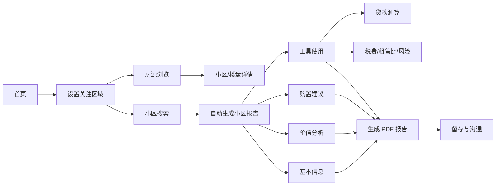
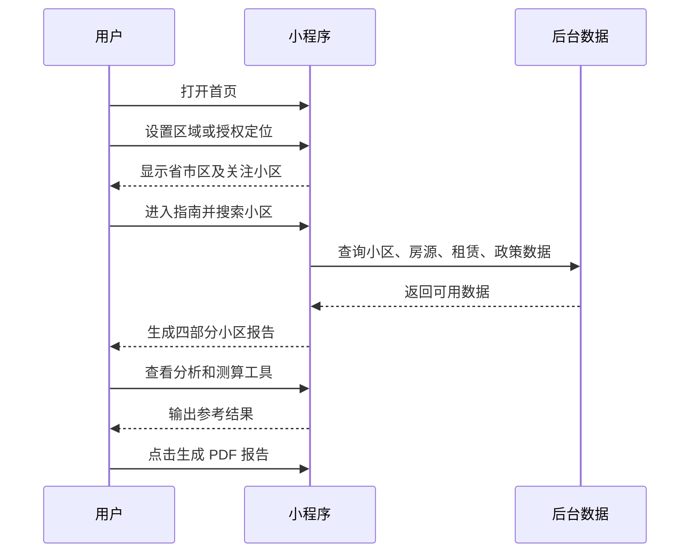
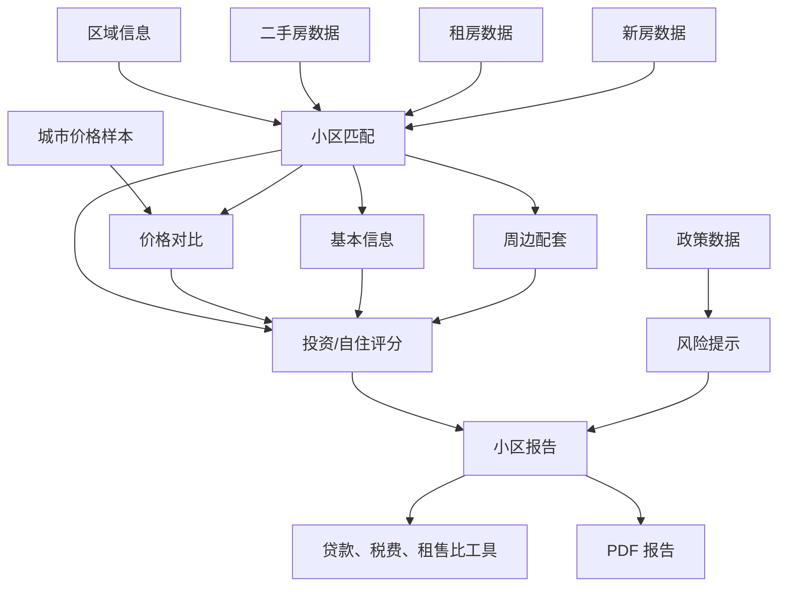

# 购房指南小程序产品说明

> **图文详版｜产品发布、内部培训与客户介绍**


**产品名称：** 购房指南  
**文档版本：** v1.1  
**文档用途：** 公司产品发布、销售介绍、内部培训、用户操作指导  
**产品形态：** 微信小程序

---

## 一、产品一句话介绍

**购房指南是一款帮助用户完成“找区域、看房源、查小区、比价格、做测算、出报告”的购房决策工具。**

用户只需要先选择关注区域，再搜索目标小区，系统就会根据后台收录的小区、房源、成交、租赁、配套和政策数据，自动生成一份结构化的小区分析报告。用户还可以进一步测算贷款月供、交易税费、租售比和法拍交易成本，并导出 PDF 报告。

### 产品核心价值

| 用户问题 | 产品解决方式 |
|---|---|
| 房价、成交、租金和配套信息分散 | 集中展示在小区报告中 |
| 不知道多个小区如何比较 | 提供城市均价、小区均价、成交价和竞品对比 |
| 不清楚房子适不适合投资或自住 | 生成投资、自住两个维度的参考评分 |
| 不知道买房后每月还款多少 | 支持商业、公积金和组合贷款测算 |
| 家庭成员之间难以沟通分析结果 | 生成 PDF 报告，便于留存和讨论 |


---

## 二、产品定位与适用人群

### 2.1 产品定位

购房指南定位为**购房前期的信息整理与决策参考工具**，重点帮助用户完成以下工作：

- 快速确定关注城市、区域和小区。
- 了解目标小区的基础信息和市场价格。
- 对比近期成交、挂牌、租赁和周边竞品情况。
- 从投资和自住角度理解小区适配度。
- 测算贷款、税费和持有收益等关键数字。
- 将阶段性分析整理为一份可阅读、可沟通的报告。

### 2.2 适用人群

- 首次购房用户。
- 正在比较多个小区的刚需和改善型家庭。
- 关注租金回报和长期持有收益的投资用户。
- 需要预估首付、月供和交易成本的购房家庭。
- 需要整理房产信息、制作分析材料的顾问和业务人员。

### 2.3 典型使用场景

**场景一：看房前快速了解小区**  
用户在到访小区前，先查看小区位置、楼龄、物业、价格、交通、教育和近期成交信息。

**场景二：多个小区横向比较**  
用户分别搜索多个小区，对比小区均价、城市均价、近期成交价、租售比和配套情况。

**场景三：购房预算测算**  
用户输入房屋总价、首付比例、贷款期限和利率，查看预计月供、累计还款和利息。

**场景四：家庭共同决策**  
用户生成 PDF 报告，将价格、购置建议、测算结果和风险提示发送给家人讨论。

---

## 三、产品功能总览



### 四个主入口

| 主入口 | 核心作用 | 用户可以完成的任务 |
|---|---|---|
| **首页** | 快速开始评估 | 设置区域、进入快捷工具、查看当前关注小区 |
| **房源** | 浏览市场房源 | 按城市和房源类型查找小区、二手房、租房、新房 |
| **指南** | 生成小区报告 | 查看基本信息、价格分析、购置建议和测算工具 |
| **我的** | 管理个人记录 | 查看定位、登记记录、清除本地数据和查看版本信息 |


---

## 四、详细功能说明

## 4.1 首页：进入房产评估流程

首页是小程序的总入口，围绕“快速开始一次房产分析”设计。

### 页面功能

1. **房产价值评估入口**  
   点击首页主按钮进入小区报告流程。

2. **关注区域设置**  
   显示当前省份、城市、区/县及楼盘、小区信息。未设置时，提示用户先选择关注区域。

3. **快捷工具**  
   提供四个快捷入口：
   - 基本信息：查看和补充房产基础资料。
   - 房源分析：分析销售价、评估价、成交和租售情况。
   - 评估结论：汇总购房分析结果。
   - 按揭测算：测算贷款月供和累计还款。

4. **评估流程提示**  
   首页通过“从基础信息到专业结论”的提示，引导用户逐步完成分析。

### 推荐使用方式

首次使用时，建议按以下顺序操作：

**设置区域 → 进入指南 → 搜索小区 → 查看报告 → 使用测算工具 → 导出 PDF**


---

## 4.2 定位与区域设置：确定分析范围

区域信息会影响房源查询、小区搜索、城市均价和报告内容，是使用产品的第一步。

### 支持的设置方式

- GPS 自动识别所在城市。
- 手动选择省份、城市和区/县。
- 对无法自动匹配的区/县进行手动输入。
- 补充楼盘名称、楼栋数量和小区名称。

### 操作步骤

1. 在首页点击“设置当前关注区域”或“修改区域”。
2. 点击“GPS 自动定位”，按微信提示授权定位；也可以直接手动选择。
3. 依次选择省份、城市和区/县。
4. 填写楼盘名称、栋数和小区名称，可按实际情况补充。
5. 检查页面预览内容，点击“保存定位”。
6. 返回首页或指南页面继续搜索小区。

### 使用提示

- GPS 主要用于识别城市，识别后可以手动调整。
- 如果当前位置超出当前数据覆盖范围，可以手动选择城市。
- 小区名称尽量填写完整，以便匹配后台数据。


---

## 4.3 房源：浏览城市、小区和楼盘

房源页面用于发现和筛选市场数据，支持城市切换、房源类型筛选和关键词搜索。

### 房源类型

- **全部：** 查看当前城市收录的小区数据。
- **二手房：** 查看二手房小区和收录房源数量。
- **租房：** 查看租赁小区和租房信息。
- **新房：** 查看新房楼盘、户型、状态和价格。

### 页面操作

1. 进入底部导航“房源”。
2. 点击城市卡片，搜索或选择城市。
3. 也可以点击 GPS 定位当前城市。
4. 点击“全部、二手房、租房、新房”切换数据类型。
5. 在搜索框输入小区名或楼盘名。
6. 点击结果进入小区详情、房源详情或房源分析。

### 可以看到的信息

**小区列表：** 小区名称、房源数量、数据摘要和部分评分。  
**新房列表：** 楼盘名称、户型、销售状态、区域地址、单价和总价。  
**房源详情：** 根据后台数据查看具体房源信息，并可进入分析入口。


---

## 4.4 指南：自动生成小区报告

“指南”是产品的核心页面。它将小区相关数据整理为四个分析部分，用户无需逐项填写即可开始查看。

### 报告生成步骤

1. 进入底部导航“指南”。
2. 确认当前省、市、区/县是否正确。
3. 在“输入小区名称”框中输入关键词。
4. 从搜索结果中选择目标小区。
5. 等待系统读取小区、房源和政策数据。
6. 在四个报告页签之间切换查看。
7. 展开评分、工具和风险提示，查看详细依据。
8. 点击页面底部“生成 PDF 报告”。

### 报告状态提示

- **正在读取后台数据：** 系统正在汇总数据。
- **后台数据完整：** 当前报告所需主要字段已取得。
- **后台有若干项数据缺失：** 部分字段没有收录，需要线下补充核验。
- **暂无数据：** 当前字段没有可展示的数据，不代表实际不存在该信息。

---

## 4.5 报告模块一：基本信息

基本信息用于快速了解目标小区的基础情况。

### 主要字段

- 位置和小区名称。
- 户型分布。
- 房屋性质。
- 建成年代和楼龄。
- 建筑类型。
- 总户数和楼栋数。
- 成交套数。
- 开发商和物业公司。
- 物业费。
- 容积率和绿化率。
- 车位配比。
- 区域排名。
- 参考均价和挂牌情况。

### 用户价值

这一部分适合用于看房前的快速了解，也适合在多个小区之间进行基础条件比较。对于楼龄、物业、车位和建筑类型等信息，建议在实地看房和交易前进一步核验。

---

## 4.6 报告模块二：价值分析

价值分析将不同来源的价格数据放在同一页面中进行比较。

### 价格对比维度

- 城市均价。
- 小区均价。
- 楼盘近期平均成交价。
- 楼盘近期法拍成交价。
- 楼盘平均挂牌价。
- 系统评估价格。

页面通过横向价格条展示不同指标的相对位置，并在下方提供价格明细。

### 其他分析内容

- 楼盘平均租金。
- 历史价格走势。
- 近期成交记录。
- 周边竞品小区及其价格样本。

### 如何理解结果

- 城市均价用于观察目标小区在城市整体市场中的位置。
- 小区均价用于了解目标小区的主要价格水平。
- 近期成交价更接近近期市场交易情况，但样本数量和房屋差异会影响结果。
- 挂牌价是卖方报价，不等于最终成交价。
- 评估价格是系统基于已有数据的参考结果，不替代专业评估报告。


---

## 4.7 报告模块三：购置建议

购置建议用于帮助用户从不同购房目的理解小区适配度，不直接替代用户做出购买决定。

### 投资维度

投资评分由三个分项构成：

1. **租赁指数**  
   参考年租售比和在租套数，用于了解租金回报和出租活跃度。

2. **销售指数**  
   参考评估价格、近期成交或法拍价格，以及在售套数，用于了解价格差异和交易活跃程度。

3. **融资指数**  
   参考评估价与成交价之间的差异、挂牌套数等条件，用于提示潜在的价格空间和流动性问题。

### 自住维度

1. **刚需型**  
   参考面积、学区、交通和医疗配套，更适合基础居住需求分析。

2. **改善型**  
   参考面积、户型、景观资源和四房等户型特征，更适合改善型需求分析。

3. **度假型**  
   参考海边、公园、景区、高尔夫、温泉等休闲和景观资源。

### 页面展示方式

- 显示投资和自住综合评分。
- 显示“高度推荐、较为推荐、谨慎考虑、适配度较低”等参考等级。
- 使用分项图表展示各项分数占比。
- 点击分类卡片查看判断标准和具体计算依据。

### 重要说明

评分是根据当前后台数据和产品规则计算的参考结果。数据不完整时，评分可能受到影响。用户应结合家庭需求、预算、购房资格和现场情况综合判断。

---

## 4.8 报告模块四：工具使用

工具使用页面将常见购房计算集中展示，用户可以点击卡片展开计算过程。

### 贷款测算

支持：

- 商业贷款。
- 公积金贷款。
- 组合贷款。
- 等额本息。
- 等额本金。

输入信息：

- 房屋总价。
- 首付比例。
- 贷款期限。
- 还款方式。
- 商业贷款利率。
- 公积金贷款利率。
- 组合贷款的商业贷款占比。

输出结果：

- 贷款总额。
- 首月月供。
- 末月月供。
- 累计还款。
- 支付利息。

### 交易税费参考

页面会根据计税总价和部分房屋条件，对契税等费用进行参考估算，同时提示增值税、个人所得税、登记费和服务费需要结合实际情况核算。

### 租售比

基本公式为：

```text
年租售比 = 月租金单价 × 12 ÷ 房屋单价 × 100%
```

结果用于观察租金收入与房价之间的关系，但没有自动等同于净收益率，因为实际持有还可能产生空置、维修、物业、税费和资金成本。

### 法拍交易成本

法拍房成本参考会提醒用户关注：

- 拍卖成交价。
- 过户税费。
- 物业、水电和其他历史欠费。
- 腾退和交付成本。
- 保证金、尾款期限和融资成本。

### 风险提示

系统会提示楼龄、贷款年限、房屋占用、腾退、租赁和唯一住房等需要进一步核实的事项。

---

## 4.9 基本信息、房源分析和评估结论

除自动报告外，产品还提供分模块录入和分析入口，适合需要补充个人判断或现场信息的用户。

### 基本信息

可查看或补充：

- 小区和区位。
- 区域排名。
- 交通和学区。
- 周边竞品。
- 平均价格和近期成交价。
- 成交量。
- 楼龄、税费和面积。

### 房源分析

可分析：

- 销售价和评估价。
- 好成交价格。
- 租售比和年化回报率。
- 成交量与价格走势。
- 国家和地方房地产政策。

### 评估结论

用于集中查看四个分析部分的结果，适合在完成信息补充后形成阶段性结论，并导出 PDF 报告。

---

## 4.10 我的：管理使用记录

“我的”页面用于管理个人侧信息和本地记录。

### 页面功能

- 查看当前定位。
- 查看已登记的购房评估记录。
- 删除单条记录。
- 清除定位、表单和登记记录等本地数据。
- 查看“关于”信息和当前产品版本。

### 注意事项

记录主要保存在当前设备本地。点击“清除本地数据”后，相关定位、表单和登记记录将被清除，清除前请确认是否仍需要保留。


---

## 五、完整操作指南

## 5.1 第一次使用：从零开始生成报告



### 操作清单

- [ ] 已设置省份、城市和区/县。
- [ ] 已选择正确的小区。
- [ ] 已确认报告更新时间。
- [ ] 已查看基本信息。
- [ ] 已对比城市、小区、成交和挂牌价格。
- [ ] 已查看投资和自住建议。
- [ ] 已展开风险提示和缺失字段。
- [ ] 已根据预算完成贷款测算。
- [ ] 已对关键数据进行线下核验。

## 5.2 浏览房源

1. 点击底部“房源”。
2. 点击城市卡片切换城市，或使用 GPS 定位。
3. 选择“二手房、租房、新房”等类型。
4. 输入小区或楼盘名称。
5. 点击列表结果查看详情。
6. 新房列表可以继续向下滚动加载。

## 5.3 生成月供测算

1. 进入“指南”。
2. 搜索并选择小区。
3. 打开“工具使用”。
4. 展开“贷款测算”。
5. 选择贷款类型。
6. 输入房屋总价和首付比例。
7. 选择贷款年限、还款方式和利率。
8. 点击“开始计算”。
9. 查看月供、累计还款和支付利息。

## 5.4 导出 PDF 报告

1. 完成区域和小区选择。
2. 等待报告读取完成。
3. 查看四个报告部分。
4. 检查数据更新时间和缺失字段。
5. 点击页面底部“生成 PDF 报告”。
6. 根据微信提示查看、保存或转发文件。

---

## 六、数据架构与报告生成逻辑



### 数据处理原则

1. 根据城市和小区名称匹配后台数据。
2. 汇总二手房、租房和相关成交数据。
3. 计算价格均值、价格对比和趋势信息。
4. 提取交通、教育、医疗和竞品信息。
5. 根据已有字段计算投资和自住参考评分。
6. 对缺失字段进行标识，不用空数据替代真实数据。
7. 将分析结果展示在报告和测算工具中。

---

## 七、数据来源、更新与缺失说明

### 7.1 数据内容

产品可能使用以下后台数据：

- 小区和房源基础信息。
- 二手房挂牌与成交信息。
- 租房和租金信息。
- 新房楼盘信息。
- 城市价格样本和小区价格样本。
- 交通、教育、医疗等周边配套信息。
- 房地产政策信息。
- 法拍房和相关交易参考信息。

### 7.2 数据更新时间

报告页面会显示数据状态和更新时间。不同字段可能来自不同数据源，因此更新时间和完整程度可能存在差异。

### 7.3 数据缺失

当后台未收录某项数据时，页面可能显示：

- 暂无数据。
- 后台暂无相关数据。
- 数据完整性中显示缺失字段。
- 空的列表或空状态页面。

数据缺失只表示当前系统没有可展示的数据，不代表现实中不存在该信息。用户应通过官方渠道、开发商、物业、经纪机构或实地调查进一步核实。

---

## 八、结果解释和使用边界

### 8.1 价格与评分

均价、评估价、建议价格、趋势、投资评分和自住评分，均是基于当前后台数据和产品规则生成的参考结果：

- 不构成专业房地产估值报告。
- 不构成房屋交易报价。
- 不构成投资收益承诺。
- 不构成对具体房屋的购买保证。

### 8.2 贷款测算

贷款测算是预算估算工具，实际结果还取决于：

- 银行授信政策。
- 借款人的征信、收入和负债情况。
- 实际贷款利率。
- 房屋性质和楼龄。
- 首付比例及当地购房政策。

实际贷款额度、利率、期限和审批结果以银行审核为准。

### 8.3 税费测算

契税、增值税、个人所得税、登记费和服务费会受到房屋性质、面积、持有年限、家庭住房套数、交易双方约定和当地政策影响。系统结果仅供预算参考，实际金额以当地税务、不动产登记机构和交易办理结果为准。

### 8.4 法拍房核验

法拍房交易前应重点核验：

- 拍卖公告和法院执行裁定。
- 房屋产权、抵押和查封情况。
- 是否有人居住或出租。
- 是否存在腾退障碍。
- 是否涉及唯一住房风险。
- 物业、水电、土地出让金等历史欠费。
- 过户、交付和贷款条件。

---

## 九、购房决策建议

建议用户按照“数据查看、现场核验、专业确认、综合决策”的顺序使用产品：

1. 使用小程序快速筛选城市和小区。
2. 查看基本信息、价格分析和配套数据。
3. 结合自身预算完成贷款和税费测算。
4. 查看投资、自住建议和风险提示。
5. 到现场核实房屋、社区和周边环境。
6. 通过官方渠道核实产权、政策和税费。
7. 结合家庭需求、购房资格和现金流做最终决定。

**小程序的作用是提高前期筛选和信息整理效率，最终交易决定应建立在真实、完整、经过核验的信息之上。**

---

## 十、对外发布文案

### 10.1 一句话版

> 购房指南，帮你从找小区到做决策，把房源数据、价格分析、贷款测算和购置建议集中在一个小程序里。

### 10.2 短介绍版

> 购房指南是一款面向购房决策的小程序。用户设置关注区域并选择小区后，可以查看小区基本信息、城市和小区价格对比、近期成交、租金、周边配套以及投资和自住参考建议。同时，产品提供贷款月供、交易税费、租售比和法拍交易成本等测算工具，并支持生成 PDF 分析报告，帮助用户更高效地完成购房前期筛选和家庭沟通。

### 10.3 完整介绍版

> 从确定城市，到比较小区，再到测算月供，购房指南帮助用户完成购房前期分析的关键步骤。通过设置关注区域并搜索小区，用户可以快速获得基本信息、价格全景、成交与租赁情况、周边交通教育配套和竞品信息。系统还会从投资和自住两个角度生成参考建议，并提供商业贷款、公积金贷款、组合贷款、交易税费和租售比等工具。分析结果可以整理为 PDF 报告，方便个人留存、家庭讨论和后续决策。产品中的数据、评分和测算结果仅供参考，实际交易请以官方信息、银行审批和线下核验结果为准。

---

## 十一、版本信息

当前说明文档根据小程序现有页面和功能整理，版本为 **v1.1**。

后续如果增加以下能力，建议同步更新产品说明：

- 用户注册、登录和云端账号。
- 收藏小区、收藏房源和历史报告。
- 用户之间分享报告。
- 在线咨询或经纪服务入口。
- 更丰富的地图和周边配套展示。
- 更多城市和数据源。
- 隐私政策、用户协议和数据授权说明。

> **发布前检查建议：** 对外发布前，请产品负责人确认小程序名称、数据来源、覆盖城市、PDF 导出方式、隐私授权文案和客服联系方式是否为当前线上版本。
